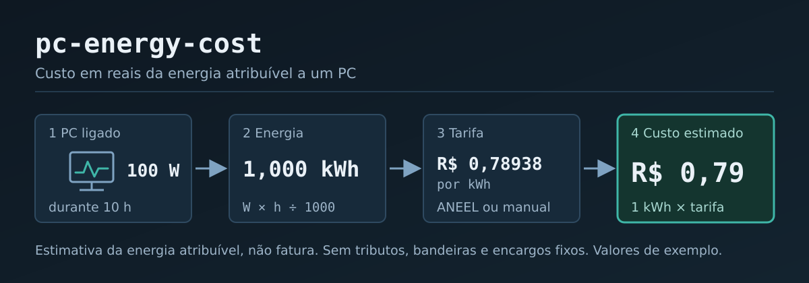

# pc-energy-cost



Estima, em BRL, o custo da energia atribuível a um PC ligado por uma duração planejada ou medida.

**É uma estimativa da energia atribuível, não uma fatura.** Veja "Limites e avisos" abaixo.

Programa de linha de comando em Python (3.11 ou superior), sem agente, sem LLM e sem serviço pago no
runtime. A tarifa vem do dado aberto da ANEEL (ou é informada manualmente); a potência é informada,
lida de um CSV ou, opcionalmente, medida por telemetria do próprio computador.

## Instalação

A partir de um checkout do código-fonte:

```
python -m pip install .
```

Para desenvolvimento (inclui `pytest` e `build`):

```
python -m pip install -e ".[dev]"
```

A partir de um sdist ou wheel gerado localmente:

```
python -m build
python -m pip install dist/pc_energy_cost-0.1.0-py3-none-any.whl
```

O pacote `tzdata` é dependência condicional apenas no Windows (que não traz o banco de fusos do
IANA); o `pip` o instala sozinho nessa plataforma. No Linux usa-se o banco de fusos do sistema. Sem
dados de fuso o programa falha com o erro `timezone_data_missing`.

Depois de instalado, o comando é `pc-energy-cost` (ou `python -m pc_energy_cost`).

## Uso

Os exemplos abaixo foram executados com um banco isolado (`PC_ENERGY_COST_DB`) e funcionam sem
rede. A pasta de dados padrão é a do usuário na plataforma; a variável `PC_ENERGY_COST_DB` indica
outro arquivo SQLite (o cache de downloads fica ao lado, com sufixo `.cache`).

Estimativa com potência e horas informadas e tarifa manual (sem rede):

```
pc-energy-cost estimar --potencia 100 --horas 10 --tarifa-manual-total 0,78938
```

Saída (trecho): `Custo estimado: R$ 0,79` e `Energia: 1,000 kWh`.

Tarifa manual que já inclui tributos e bandeira, com saída JSON (schema versão `"1"`):

```
pc-energy-cost estimar --potencia 100 --horas 10 --tarifa-manual-total 0,80 --inclui tributos --inclui bandeira --json
```

Série CSV `timestamp,watts` (fixtures sintéticas do repositório), integrada por degraus:

```
pc-energy-cost estimar --serie-csv tests/fixtures/metering/serie_valida.csv --tarifa-manual-total 0,78938 --max-gap 5m
pc-energy-cost estimar --serie-csv tests/fixtures/metering/serie_gap.csv --tarifa-manual-total 0,78938
```

O segundo exemplo tem um intervalo de 55 minutos maior que o `--max-gap` padrão (5 min): o intervalo
é excluído, o resultado é marcado como dados parciais e o custo cobre só a parte coberta. Com
`--max-gap 1h` o mesmo arquivo é integrado por inteiro. Se nada puder ser coberto, o erro é
`insufficient_coverage`; nunca se devolve `R$ 0,00` por falta de dados.

Período por data e hora (naive = `America/Sao_Paulo`):

```
pc-energy-cost estimar --potencia 100 --inicio 2026-10-19T08:00 --fim 2026-10-19T18:00 --tarifa-manual-total 0,80 --inclui tributos
```

Tarifa automática da ANEEL (exige rede; o primeiro download do catálogo é grande, na casa de
200 MB, e não foi executado ao validar estes exemplos de README; o teste live A51 o exercita):

```
pc-energy-cost atualizar-catalogo
pc-energy-cost estimar --distribuidora 61695227000193 --potencia 100 --horas 10
pc-energy-cost estimar --municipio 3550308 --distribuidora 61695227000193 --potencia 100 --horas 10
```

Opções principais de `estimar`: `--potencia`, `--cenario-potencia-nominal`, `--serie-csv`,
`--horas` ou `--inicio`/`--fim`, `--max-gap`, `--trapezio`, `--municipio`, `--distribuidora`,
`--tarifa-manual-total`, `--inclui`, `--adicional-kwh`, `--adicional-tipo`,
`--projetar-ultima-tarifa`, `--rapl-max-watts`, `--permitir-cache-vencido`, `--json`. Sem
`--potencia`, `--cenario-potencia-nominal` ou `--serie-csv`, o programa tenta medir por telemetria
(RAPL no Linux, WMI no Windows); veja `docs/telemetria.md`.

### Política de tarifa manual e adicional

- `--tarifa-manual-total` é uma tarifa all-in em R$/kWh; `--inclui` declara o que ela contém
  (`tributos`, `bandeira`, ...). Sem `--inclui` a saída mostra `nao-declarado`.
- `--adicional-kwh` com `--adicional-tipo` soma um valor por kWh (por exemplo, bandeira) à tarifa.
  Declarar a mesma inclusão na tarifa manual e no adicional é `double_inclusion`; adicional sobre
  tarifa manual sem inclusões declaradas é `inclusion_undeclared`.
- Tarifa manual `0` é aceita com o aviso `zero_rate`; negativa ou fora dos limites é `invalid_input`.

## Limites e avisos

- Resultado = estimativa da energia atribuível ao PC. Não é a fatura residencial.
- A tarifa automática é a B1 residencial convencional (Tarifa de Aplicação, TUSD + TE por MWh) da
  distribuidora e **não inclui tributos nem bandeiras tarifárias**.
- O catálogo de distribuidoras e municípios é parcial e indicativo: o vínculo município e
  distribuidora vem de indicadores de qualidade da ANEEL, não de cadastro de concessão, e pode haver
  mais de uma distribuidora por município (a capital de São Paulo é ambígua). Nesse caso o programa
  devolve `supplier_ambiguous` (saída 3) com as candidatas, em vez de adivinhar; use
  `--distribuidora` com o CNPJ.
- Os dados reais da ANEEL têm créditos negativos de TUSD/TE em outras classes de tarifa; eles são
  guardados como vieram, sem interpretação, e não afetam o perfil B1 residencial convencional.
- Limites de entrada (D14): potência até 100000 W com até 3 casas decimais; horas até 87600 com até
  4 casas; tarifa manual até 100 R$/kWh com até 6 casas; `--max-gap` de 1 s a 24 h; `--rapl-max-watts`
  de 1 a 10000. Textos numéricos têm no máximo 32 caracteres. Valores `nan`, `inf`, negativos ou
  ambíguos (`1,234.5`, `1.234`) são rejeitados.
- Arredondamento HALF_UP só na apresentação; os cálculos internos usam `Decimal`.
- Telemetria: RAPL mede só o pacote da CPU (escopo `cpu_package`); WMI é sempre `component`. Nunca
  se apresenta medição de tomada. Os limites de amostragem do RAPL são provisórios e não medidos.

## Códigos de saída

| Código | Significado | Exemplos de erro |
|---|---|---|
| 0 | sucesso | |
| 2 | entrada inválida | `invalid_input`, `ambiguous_decimal`, `double_inclusion`, `inclusion_undeclared`, `timezone_data_missing`, `csv_*`, `insufficient_coverage` (série CSV) |
| 3 | escolha ou resultado ambíguo/sem suporte | `supplier_ambiguous`, `unsupported`, `tariff_ambiguous` |
| 4 | dados de tarifa/catálogo | `tariff_not_found`, `tariff_not_in_effect`, `schema_mismatch`, `unexpected_html`, `download_incomplete`, `cache_corrupted` |
| 5 | sem rede | `network_unavailable` |
| 6 | indisponível | `unavailable`, `insufficient_coverage` (telemetria por contador) |

Com `--json`, erros saem como documento JSON em stdout com `error.code`.

## Testes

```
python -m pytest                 # suíte padrão
python -m pytest -m install      # sdist -> wheel -> venv limpo (usa a rede)
python -m pytest -m live         # ANEEL e RAPL reais (rede/hardware)
python -m pytest -m live_windows # só em Windows real
```

Números reais (`pytest --collect-only -q`): 395 testes coletados, dos quais 391 rodam na suíte
padrão (391 aprovados na última execução) e 4 são excluídos por marcador (A50 `install`, A51 e A52
`live`, A53 `live_windows`). Os 53 cenários planejados (A1 a A53) estão mapeados a uma função cada
em `docs/matriz-requisitos-testes.md`; eles não equivalem a 53 testes aprovados.

Situação dos testes que dependem de ambiente:

- A51 (ANEEL real) passou em 2026-10-19 contra dados reais, com a REH vigente naquele dia
  (observação pontual: o teste falha de propósito se a REH mudar).
- A52 (RAPL real) foi pulado no host de desenvolvimento com o motivo `zone_disabled`; isso não se
  generaliza para outros hosts.
- A53 e o provider WMI nunca foram testados em Windows real (somente fakes).
- A CI (`.github/workflows/ci.yml`) roda a suíte padrão em Ubuntu e Windows; o Windows nunca foi
  executado localmente por este projeto, então falhas específicas dessa plataforma ainda podem
  aparecer na primeira execução.

## Documentação

[docs/architecture.md](docs/architecture.md) (fluxo da entrada até a saída, com diagrama),
[docs/arquitetura.md](docs/arquitetura.md), [docs/fontes-de-dados.md](docs/fontes-de-dados.md),
[docs/telemetria.md](docs/telemetria.md), [docs/extensoes.md](docs/extensoes.md),
[docs/checklist-instalacao.md](docs/checklist-instalacao.md) e
[docs/matriz-requisitos-testes.md](docs/matriz-requisitos-testes.md).

## Licença

MIT (ver `LICENSE`). Copyright (c) 2026 Fet0b.
