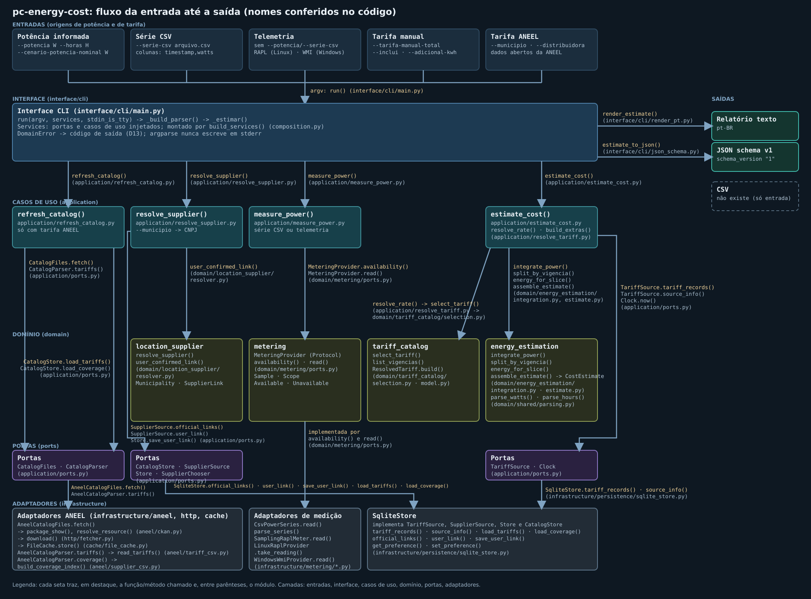

# Arquitetura: fluxo da entrada até a saída

Este documento mostra o caminho de uma chamada `estimar` pelo código real. Cada nome citado
(função, método, classe, porta) foi conferido no código-fonte; o módulo vem entre parênteses.
Para as regras de camadas (quem pode importar quem), veja também [arquitetura.md](arquitetura.md).

O desenho está em SVG (vetorial) para poder ser ampliado: abra
[images/arquitetura.svg](images/arquitetura.svg) diretamente no navegador. Em cada seta, a primeira
linha é a função ou método chamado e as seguintes trazem o módulo entre parênteses.

## Camadas

| Camada | Pacote | O que contém |
|---|---|---|
| Interface | `interface/cli` | `run()`, `_build_parser()`, `_estimar()` (`main.py`); `render_estimate()` (`render_pt.py`); `estimate_to_json()` (`json_schema.py`) |
| Casos de uso | `application` | `refresh_catalog()`, `resolve_supplier()`, `measure_power()`, `estimate_cost()`, `resolve_rate()`, `build_extras()` |
| Domínio | `domain` | `integrate_power()`, `split_by_vigencia()`, `energy_for_slice()`, `assemble_estimate()` e `CostEstimate`; `select_tariff()`, `list_vigencias()`, `ResolvedTariff.build()`; `resolve_supplier()` e `user_confirmed_link()`; `MeteringProvider`; `parse_watts()`, `parse_hours()` |
| Portas | `application/ports.py`, `domain/metering/ports.py` | `TariffSource`, `SupplierSource`, `Clock`, `Store`, `SupplierChooser`, `CatalogFiles`, `CatalogParser`, `CatalogStore`, `MeteringProvider`; de sessão: `LiveMeter`, `SessionLedger`, `SummaryExporter`, `BootIdentity`, `MonotonicClock` |
| Adaptadores | `infrastructure` | `AneelCatalogFiles`, `AneelCatalogParser`, `SqliteStore`, `FileCache`, `CsvPowerSeries`, `SamplingRaplMeter`, `LinuxRaplProvider`, `WindowsWmiProvider`; de sessão: `SqliteSessionLedger`, `LiveRaplMeter`, `LiveWmiMeter`, `LiveManualPower`, `LinuxBootId`, `ProxmoxCompatibleTextExporter` |
| Composição | `composition.py` | `build_services()` é o único ponto que liga adaptadores a casos de uso |

## Chamadas, na ordem do fluxo

| # | Chamada | Módulo |
|---|---|---|
| 1 | `run(argv, services, stdin_is_tty)` recebe os argumentos e usa `_build_parser()` | `interface/cli/main.py` |
| 2 | `run()` chama `_estimar()` | `interface/cli/main.py` |
| 3 | `_estimar()` chama `refresh_catalog()` (só com tarifa ANEEL, isto é, sem `--tarifa-manual-total`) | `application/refresh_catalog.py` |
| 3a | `refresh_catalog()` usa `CatalogFiles.fetch()`, `CatalogParser.tariffs()` e `CatalogParser.coverage()` | `application/ports.py` |
| 3b | implementados por `AneelCatalogFiles.fetch()`, que usa `package_show()` e `resolve_resource()` (`infrastructure/aneel/ckan.py`), `download()` (`infrastructure/http/fetcher.py`) e `FileCache.store()` (`infrastructure/cache/file_cache.py`) | `infrastructure/aneel/catalog_adapters.py` |
| 3c | `AneelCatalogParser.tariffs()` chama `read_tariffs()` e `AneelCatalogParser.coverage()` chama `build_coverage_index()` | `infrastructure/aneel/tariff_csv.py`, `infrastructure/aneel/supplier_csv.py` |
| 3d | `refresh_catalog()` grava com `CatalogStore.load_tariffs()` e `CatalogStore.load_coverage()`, implementados por `SqliteStore` | `infrastructure/persistence/sqlite_store.py` |
| 4 | `_estimar()` chama `resolve_supplier()` (com `--municipio`) | `application/resolve_supplier.py` |
| 4a | `resolve_supplier()` usa `SupplierSource.official_links()`, `SupplierSource.user_link()` e `Store.save_user_link()`; a escolha do usuário vira vínculo com `user_confirmed_link()` | `application/ports.py`, `domain/location_supplier/resolver.py` |
| 5 | `_estimar()` chama `measure_power()` (com `--serie-csv` ou sem `--potencia`, isto é, telemetria) | `application/measure_power.py` |
| 5a | `measure_power()` usa `MeteringProvider.availability()` e `MeteringProvider.read()` | `domain/metering/ports.py` |
| 5b | `CsvPowerSeries.read()` chama `parse_series()` | `infrastructure/metering/csv_series.py` |
| 5c | `SamplingRaplMeter.read()` chama `LinuxRaplProvider.take_reading()` repetidamente | `infrastructure/metering/linux_rapl.py` |
| 5d | `WindowsWmiProvider.read()` (somente leitura; nunca testado em Windows) | `infrastructure/metering/windows_wmi.py` |
| 6 | `_estimar()` chama `estimate_cost()` | `application/estimate_cost.py` |
| 6a | `estimate_cost()` chama `resolve_rate()`, que usa `build_extras()` (política de tarifa manual e adicionais) | `application/resolve_tariff.py` |
| 6b | tarifa ANEEL: `TariffSource.tariff_records()` e `TariffSource.source_info()`; depois `select_tariff()`, `list_vigencias()` (projeção) e `ResolvedTariff.build()` | `application/ports.py`, `domain/tariff_catalog/selection.py`, `domain/tariff_catalog/model.py` |
| 6c | tarifa manual: `parse_rate()` produz a taxa em R$/kWh | `domain/shared/parsing.py` |
| 7 | `estimate_cost()` converte a potência com `parse_watts()` e a duração com `parse_hours()` | `domain/shared/parsing.py` |
| 7a | com série ou contador: `integrate_power()` aplica as regras de cobertura (`--max-gap`) | `domain/energy_estimation/integration.py` |
| 7b | `split_by_vigencia()`, `energy_for_slice()` e `assemble_estimate()` produzem o `CostEstimate`; o relógio vem de `Clock.now()` | `domain/energy_estimation/estimate.py`, `application/ports.py` |
| 8 | `run()` entrega o resultado: `render_estimate()` (texto pt-BR) ou `estimate_to_json()` (JSON schema v1, com `--json`) | `interface/cli/render_pt.py`, `interface/cli/json_schema.py` |

## Fluxo de `sessao` (resumo)

`run()` chama `_acompanhar()` e, para `listar`, `custo` e `exportar`, as funções de `application/session_report.py` e `application/export_summary.py`. `track_session()` (`application/track_session.py`) lê `LiveMeter.tick()` em passos iguais que dividem o intervalo e nunca passam de `LiveMeter.max_tick_s()` (intervalo / teto(intervalo / `max_tick_s`)), atualiza o acumulador em memória, renderiza a cada intervalo e grava o batimento no `SessionLedger` a cada intervalo de persistência. As sessões vão para `sessions.sqlite`, separado do `store.sqlite`. Em `sessao`, `LiveManualPower` existe mas a CLI usa o `_AssumedPowerMeter` privado de `track_session` para potência informada. O diagrama `images/arquitetura.svg` cobre só o fluxo de `estimar`; ele não lista contextos nem portas de sessão e por isso não foi alterado.

## Origens e saídas

- **Potência:** informada (`--potencia` com `--horas`, ou `--cenario-potencia-nominal`, rotulado
  `scenario`), série CSV (`--serie-csv`, colunas `timestamp,watts`) ou telemetria (RAPL no Linux,
  WMI no Windows). A potência informada passa direto por `parse_watts()` em `estimate_cost()`:
  `ManualAverageWatts` (`infrastructure/metering/manual.py`) existe como provider, mas a CLI atual
  não o usa nesse caminho.
- **Tarifa:** ANEEL (catálogo local alimentado por `refresh_catalog()`) ou manual
  (`--tarifa-manual-total`, com `--inclui` e `--adicional-kwh`).
- **Saídas:** relatório em texto pt-BR e JSON (schema versionado). **Não existe saída CSV**: o CSV é
  apenas uma entrada de potência. O diagrama mostra a saída CSV tracejada justamente para deixar
  isso explícito.

## Como o diagrama foi conferido

Todos os nomes de função, método e classe do diagrama e das tabelas acima foram procurados no
código (`def`/`class`) e os módulos conferidos um a um; nenhum nome foi tirado de exemplo ou de
memória. Se o código mudar, atualize `images/arquitetura.svg` e esta página juntos.
